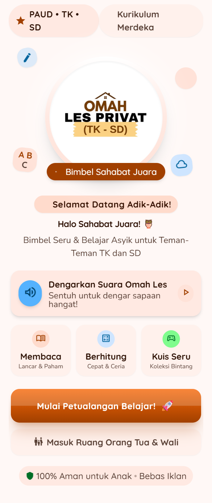
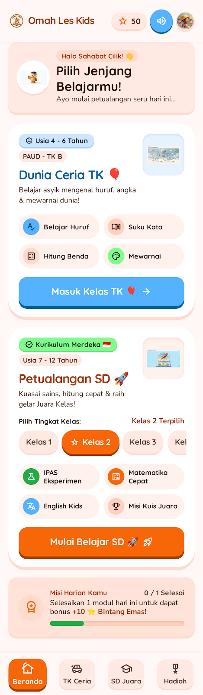

<div align="center">


# OMAH LES LEARNING PORTAL
### Interactive Multi-Tier Educational Platform for Kindergarten &bull; Grades 1–6

[](https://web-aplikasi-omahles.vercel.app)
[](https://web-aplikasi-omahles.vercel.app)
[](https://web-aplikasi-omahles.vercel.app)
[](https://github.com/faarimuhammad2502)

<br>

**A DIGITAL LEARNING SOLUTION GROUNDED IN EDUCATIONAL PSYCHOLOGY**  
*Designed, architected, and engineered by Muhammad Faari Akbar*

[Launch Live Application](https://web-aplikasi-omahles.vercel.app) &bull; [Explore Repository](https://github.com/faarimuhammad2502/web-aplikasi-belajar-omahles)

</div>

---

## EXECUTIVE OVERVIEW

**Omah Les Learning Portal** is an interactive, multi-tiered digital curriculum platform developed for private tutoring and individualized student accompaniment across Kindergarten (*TK*) and Primary School (*SD Grades 1–6*). 

Engineered from the intersection of **Educational Psychology, Child Behavior Mentoring, and Digital Product Engineering**, the platform addresses common digital learning friction: attention fatigue, passive consumption, and fragmented progress tracking. By implementing micro-scaffolding and immediate positive reinforcement loops, the system transforms standard educational worksheets into self-paced, interactive mastery experiences.

---

## INTERFACE SHOWCASE

<div align="center">

| Interactive Learning Modules | Gamified Quests & Progress |
| :---: | :---: |
|  |  |
| *Bite-sized sequential learning paths per grade* | *Micro-incentives and daily quest retention loops* |

</div>

---

## PSYCHOLOGICAL & INSTRUCTIONAL METHODOLOGY

The architecture of Omah Les Privat is informed by academic research in cognitive development and real-world shadow-teaching pedagogy:

### 1. COGNITIVE SCAFFOLDING (ZONE OF PROXIMAL DEVELOPMENT)
Curriculum content is deconstructed into bite-sized, sequential step cards. Early learners are not overwhelmed by text-heavy documents; concepts are introduced progressively, requiring active engagement before unlocking subsequent stages.

### 2. POSITIVE BEHAVIORAL REINFORCEMENT LOOPS
Leveraging operant conditioning principles, learners earn immediate visual celebration triggers and claimable reward tokens upon completing study sequences. This fosters intrinsic motivation and autonomous study habits without extrinsic anxiety.

### 3. MINIMIZED COGNITIVE LOAD
Visual hierarchy emphasizes readability, warm developmental palettes (soft amber and cream), accessible typography, and touch-optimized interactive controls suited for young motor skill development on tablets and touchscreens.

---

## CORE SYSTEM FEATURES

### MODULAR MULTI-TIER CURRICULUM
* **Kindergarten (TK):** Foundational phonetics, early numeracy, shape recognition, and sensory association.
* **Lower Primary (Grades 1–3):** Guided reading comprehension, arithmetic fundamentals, and basic thematic sciences.
* **Upper Primary (Grades 4–6):** Analytical problem solving, structured grammar, and integrated conceptual modules.

### INTERACTIVE MASTERY EVALUATION
* Instant-feedback assessment engines embedded directly within each topic module.
* Error analysis designed to encourage retry attempts rather than penalizing mistakes.

### RETENTION & PROGRESSION MECHANICS
* **Daily Quests & Weekly Milestones:** Continuous micro-goals that cultivate routine study consistency.
* **Persistent Session State:** Progress tracking, active module resumption, and earned achievements cached locally for seamless return visits.

---

## TECHNICAL ARCHITECTURE & PERFORMANCE

The portal is deliberately constructed without heavy client-side frameworks, ensuring instantaneous loading speeds even on entry-level tablets and low-bandwidth networks:

* **Frontend Engine:** Semantic HTML5, Modular CSS3 custom properties (design tokens), and clean ES6+ Vanilla JavaScript.
* **State & Persistence:** LocalStorage state caching with zero cold-start delay and persistent offline progression.
* **Delivery & Edge Network:** Hosted, optimized, and globally routed via Vercel Edge.
* **Responsive Layout:** Adaptive bento-grid reflow engineered across mobile smartphones, school-issued tablets, and desktop workstations.

---

<div align="center">

```
OMAH LES PRIVAT &bull; EMPOWERING INDIVIDUALIZED CHILD LEARNING
SCAFFOLDED PEDAGOGY &bull; DIGITAL MASTERY &bull; ZERO FRICTION
```

<sub>&copy; 2026 Omah Les Privat. Conceived, designed, and developed by <b>Muhammad Faari Akbar</b>. All rights reserved.</sub>

</div>
